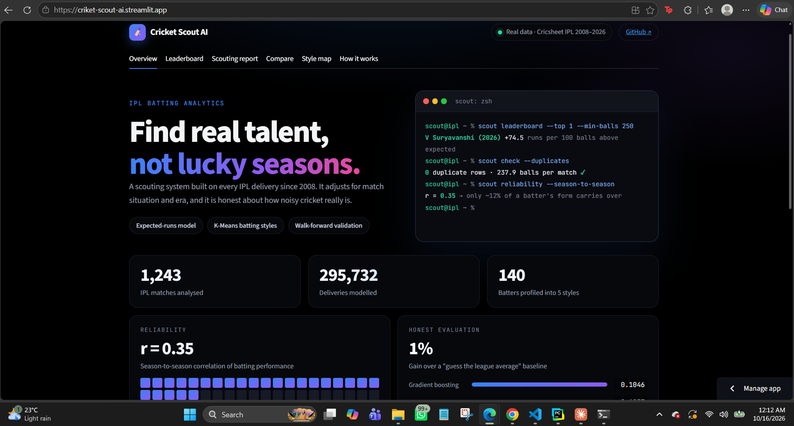

# Cricket Scout AI

Finds real batting talent in the IPL by separating skill from luck, using ball-by-ball data from 2008 to 2026.

**Live demo:** https://criket-scout-ai.streamlit.app/



## What it does
- **Expected-runs model:** estimates what a typical batter would score in the same situation, so batters are judged by "runs above expected".
- **Walk-forward validation:** every season is predicted using only earlier seasons, so there is no data leakage.
- **Batting style clusters:** K-Means groups 140 batters into 5 styles.
- **Dashboard:** leaderboard, scouting reports, head-to-head comparison and a style map.

## Results (reported honestly)
| Check | Result |
|---|---|
| Data | 1,243 matches, 295,732 deliveries |
| Expected-runs model vs constant guess | 3.1% lower error on unseen seasons |
| Next-season prediction vs league average | 0.1046 vs 0.1057 MAE, a gain of about 1% |
| Season-to-season correlation | r = 0.35, so most single-season form is luck |

## A bug worth mentioning
A combined data file silently doubled every delivery (591,464 rows instead of 295,732). I caught it by checking one player's career total against reality, then added automated validation checks.

## Tech
Python, pandas, scikit-learn, Plotly, Streamlit

## Run locally
```
pip install -r requirements.txt
streamlit run src/app.py
```

Data: Cricsheet (ball-by-ball). Not affiliated with the IPL.